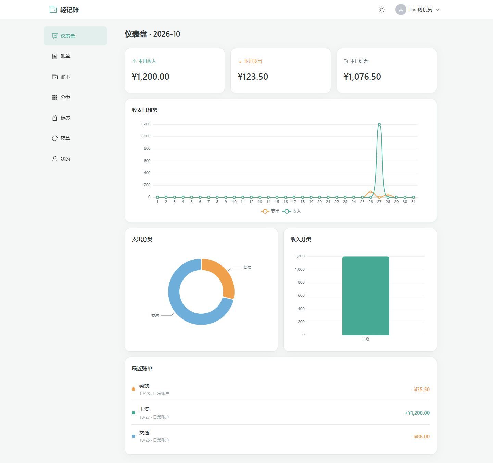
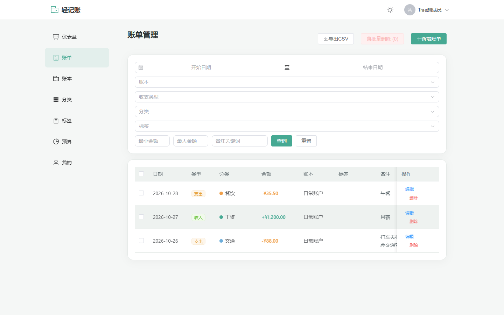
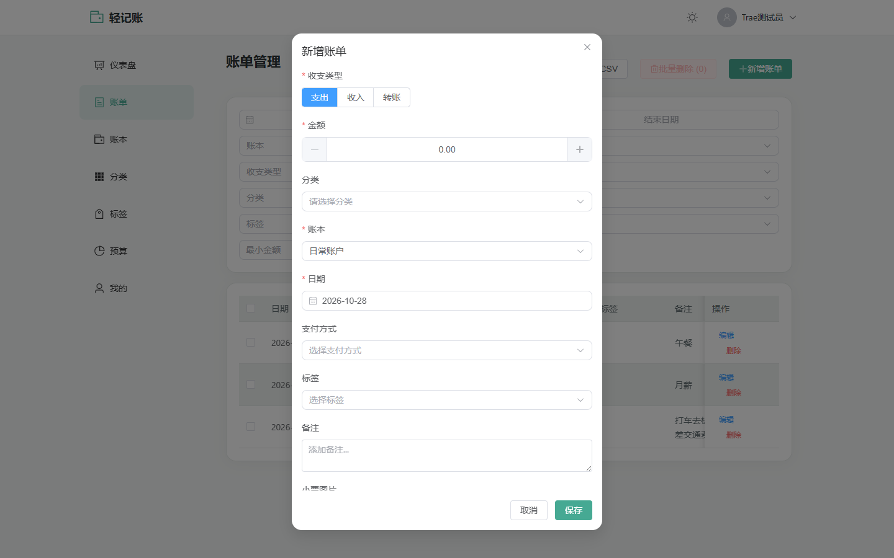
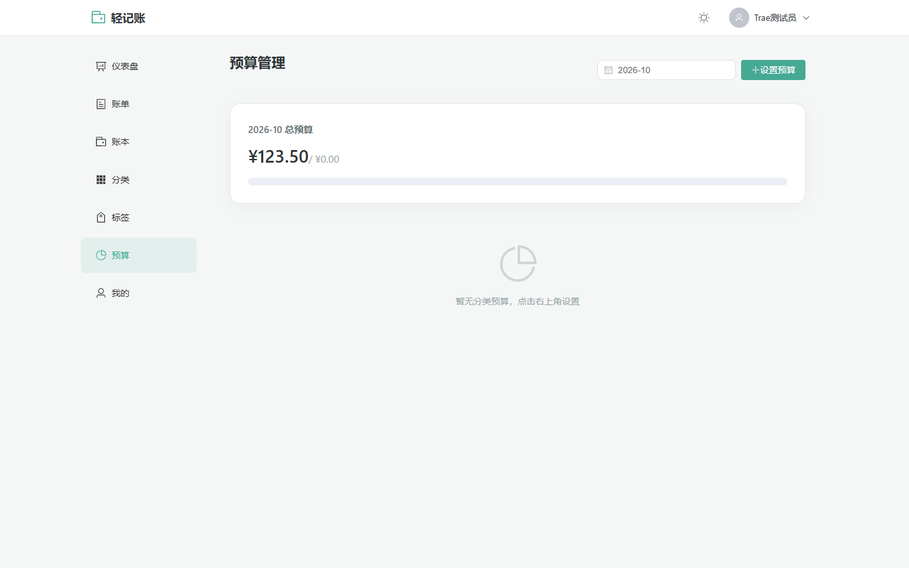
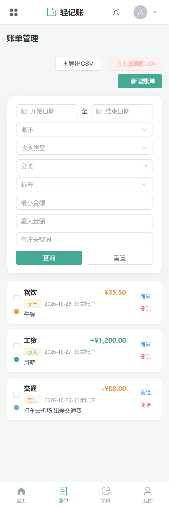

# 轻记账 · 个人财务管理

一个基于 **Vue 3 + TypeScript + Element Plus + Supabase** 的现代化个人记账应用，支持多账本、分类标签、预算管理、数据可视化与管理员后台，桌面端与移动端自适应。


---

## 功能特性

| 模块 | 说明 |
|---|---|
| 仪表盘 | 本月收入 / 支出 / 结余统计，收支日趋势折线图、支出与收入分类饼图、近 30 天柱状图、最近账单 |
| 账单管理 | 新增 / 编辑 / 删除账单，支持收入、支出、转账三种类型；按日期区间、账本、类型、分类、标签、金额区间、备注关键词筛选；批量删除；导出 CSV；上传小票图片 |
| 账本管理 | 多账本（现金、银行卡、日常账户等），支持初始余额、货币、图标，自动计算当前余额 |
| 分类管理 | 收入 / 支出分类自定义，支持图标与颜色，删除时账单关联自动置空 |
| 标签管理 | 自定义标签颜色，账单可多选标签 |
| 预算管理 | 月度总预算 + 分类预算，展示已用 / 剩余进度，同月重复预算会给出中文提示 |
| 个人中心 | 修改头像（上传至 Supabase Storage）、昵称、登录邮箱展示、修改密码 |
| 管理员后台 | 平台统计（用户数、账单数、总收入 / 总支出）与用户列表，仅 `is_admin` 用户可访问 |
| 其他 | 深浅色主题切换、路由守卫、全站中文提示、移动端卡片式账单列表 |

---

## 界面预览

| 仪表盘 | 账单管理 |
|:---:|:---:|
|  |  |

| 新增账单 | 预算管理 |
|:---:|:---:|
|  |  |

移动端账单列表（自动切换为卡片布局）：



---

## 技术栈

### 前端

| 技术 | 版本 | 用途 |
|---|---|---|
| Vue | ^3.4 | 组合式 API + `<script setup>` |
| TypeScript | ^5.5 | 类型系统 |
| Vite | ^6.0 | 开发服务器与构建工具 |
| Vue Router | ^4.6 | 路由与登录 / 管理员守卫 |
| Pinia | ^4.1 | 状态管理（auth / data / theme） |
| Element Plus | ^2.14 | UI 组件库，已配置中文 locale |
| ECharts | ^6.1 | 仪表盘图表 |
| dayjs | ^1.11 | 日期处理 |
| axios | ^1.21 | HTTP 请求 |

### 后端 / 服务

| 技术 | 用途 |
|---|---|
| Supabase Auth | 邮箱注册 / 登录 / 修改密码 |
| Supabase Postgres | 业务数据存储 |
| Supabase RLS | 行级权限，保证用户只能访问自己的数据 |
| Supabase Storage | 头像与小票图片存储（`user-assets` 公共读桶） |

---

## 项目结构

```
.
├─ docs/screenshots/          # README 截图
├─ public/                    # 静态资源
├─ src/
│  ├─ components/
│  │  └─ BillForm.vue         # 新增 / 编辑账单共用表单
│  ├─ layouts/
│  │  └─ MainLayout.vue       # 侧边栏 / 底部导航 / 主题切换
│  ├─ lib/
│  │  └─ supabase.ts          # Supabase 客户端
│  ├─ router/
│  │  └─ index.ts             # 路由表与守卫
│  ├─ stores/
│  │  ├─ auth.ts              # 登录态、用户资料
│  │  ├─ data.ts              # 账本 / 分类 / 标签 / 账单 / 预算
│  │  └─ theme.ts             # 深浅色主题
│  ├─ utils/
│  │  ├─ error.ts             # 英文错误 → 中文提示映射
│  │  └─ format.ts            # 金额 / 日期格式化
│  ├─ views/
│  │  ├─ auth/                # Login.vue、Register.vue
│  │  ├─ Dashboard.vue
│  │  ├─ Bills.vue
│  │  ├─ Ledgers.vue
│  │  ├─ Categories.vue
│  │  ├─ Tags.vue
│  │  ├─ Budget.vue
│  │  ├─ Profile.vue
│  │  └─ Admin.vue
│  ├─ App.vue
│  ├─ main.ts
│  └─ style.css
├─ supabase/migrations/       # 数据库结构、RLS 策略、Storage 桶
├─ index.html
├─ vite.config.ts
├─ vercel.json                # Vercel 部署配置（SPA 重写）
└─ package.json
```

---

## 快速开始

### 环境要求

| 依赖 | 版本要求 |
|---|---|
| Node.js | **18 及以上**（推荐 18 / 20 / 22 LTS） |
| npm | 9+（随 Node 安装） |
| Supabase | 一个 Supabase 项目（免费版即可） |
| Git | 任意较新版本 |

> Vite 5 依赖较新的 Node 语法，Node 14/16 会直接报错，请先 `node -v` 确认。

### 1. 获取代码

```bash
git clone https://github.com/zyCodedm/jizhangProject.git
cd jizhangProject
```

也可以在 GitHub 仓库页面点 **Code → Download ZIP** 解压后进入目录。

### 2. 安装依赖

```bash
npm install
```

### 3. 创建并初始化 Supabase 项目

1. 打开 [supabase.com](https://supabase.com) 注册并 **New project**，记下项目的 **Project URL** 与 **anon public key**（Project Settings → API）。
2. 在 **SQL Editor** 中按文件名顺序依次执行 `supabase/migrations/` 下的三个脚本：

   ```
   20261028022403_001_accounting_schema.sql   # 建表、索引、RLS、触发器、Storage 桶
   20261028023906_002_fix_trigger_permissions.sql
   20261028025537_003_restrict_anon_table_access.sql
   ```

   三个脚本均为幂等写法，重复执行不会破坏已有数据。

3. 脚本会自动创建公共读 Storage 桶 `user-assets`（用于头像与小票），无需手动新建。
4. 在 **Authentication → Providers → Email** 中确认邮箱登录已开启。若希望注册后免验证直接登录，可关闭 *Confirm email*。

### 4. 配置环境变量

在项目根目录新建 `.env` 文件（可直接复制 `.env.example` 后填入真实值，**不要提交到 Git**）：

```env
VITE_SUPABASE_URL=https://你的项目引用.supabase.co
VITE_SUPABASE_ANON_KEY=你的 anon public key
```

| 变量 | 说明 | 获取位置 |
|---|---|---|
| `VITE_SUPABASE_URL` | Supabase 项目地址 | Project Settings → API → Project URL |
| `VITE_SUPABASE_ANON_KEY` | 匿名公钥，前端可公开 | Project Settings → API → anon public |

> `.env` 已在 `.gitignore` 中忽略。`anon key` 受 RLS 保护，泄露风险有限，但也建议只放在部署平台的环境变量里。

### 5. 启动开发服务

```bash
npm run dev
```

浏览器访问 <http://localhost:5173>，首次使用请先注册账号。

### 6. 构建与本地预览

```bash
npm run build     # 类型检查 + 打包，产物在 dist/
npm run preview   # 本地预览 dist/ 产物
```

---

## 数据库设计

| 表 | 说明 | 关键字段 |
|---|---|---|
| `profiles` | 用户资料，随注册自动创建 | `display_name`、`avatar_url`、`is_admin` |
| `ledgers` | 账本 | `name`、`initial_balance`、`currency`、`icon` |
| `categories` | 收支分类 | `name`、`type`(income/expense)、`icon`、`color` |
| `tags` | 标签 | `name`、`color` |
| `bills` | 账单流水 | `amount`、`type`(income/expense/transfer)、`category_id`、`ledger_id`、`tag_ids`、`bill_date`、`payment_method`、`receipt_url` |
| `budgets` | 月度预算 | `month`(YYYY-MM)、`amount`、`category_id`（为空表示总预算） |

**安全策略（RLS）**

- 所有业务表均启用 RLS，按 `user_id = auth.uid()` 隔离，各自拥有 select / insert / update / delete 四条策略。
- `profiles.is_admin` 仅允许 service_role 写入，防止用户自行提权。
- 匿名用户无法访问任何业务表。
- 管理员可读取全部用户资料、账单与账本，用于后台统计。

> 要让某个账号成为管理员，在 Supabase SQL Editor 执行：
> ```sql
> update public.profiles set is_admin = true where id = '目标用户 UUID';
> ```

---

## 部署

### Vercel（推荐）

1. 将仓库导入 Vercel（Add New → Project → 选择 GitHub 仓库）。
2. Framework Preset 选 **Vite**，构建命令 `npm run build`，输出目录 `dist`（`vercel.json` 已内置）。
3. 在 **Settings → Environment Variables** 中添加：
   - `VITE_SUPABASE_URL`
   - `VITE_SUPABASE_ANON_KEY`
4. 部署完成后，把线上域名加入 Supabase **Authentication → URL Configuration** 的 Site URL / Redirect URLs。

### 其他静态托管（Netlify / Cloudflare Pages / Nginx）

- 构建命令：`npm run build`，发布目录：`dist`
- 项目使用 History 路由，需要把**所有路径回退到 `index.html`**（`vercel.json` 中的 `rewrites` 即为此配置；Nginx 用 `try_files $uri /index.html`）

---

## 常见问题

| 现象 | 原因与解决 |
|---|---|
| 启动报 `SyntaxError` / `??=` 相关错误 | Node 版本过低，升级到 18+ |
| 登录提示「邮箱或密码错误」 | 邮箱未注册或密码输错；若开启了邮箱验证，需先点邮件里的确认链接 |
| 注册提示「该邮箱已注册，请直接登录」 | 该邮箱已存在，直接登录或使用「忘记密码」流程 |
| 页面空白、数据为空 | 未登录或 RLS 拦截；确认已登录，并确认 `.env` 指向正确的 Supabase 项目 |
| 访问 `/admin` 被跳回首页 | 当前账号不是管理员，按上文 SQL 设置 `is_admin` |
| 部署后刷新子路由 404 | 静态托管缺少 SPA 回退配置，参考上文 |
| 上传图片失败 | 确认 `user-assets` 桶存在且 Storage 策略已执行（001 迁移脚本内含） |

---

## 说明

- 本项目为个人学习与实践项目，前端不含任何服务端密钥，数据安全依赖 Supabase RLS。
- 如需二次开发，建议保留 `supabase/migrations` 的历史顺序，避免直接改动已执行过的迁移文件。
